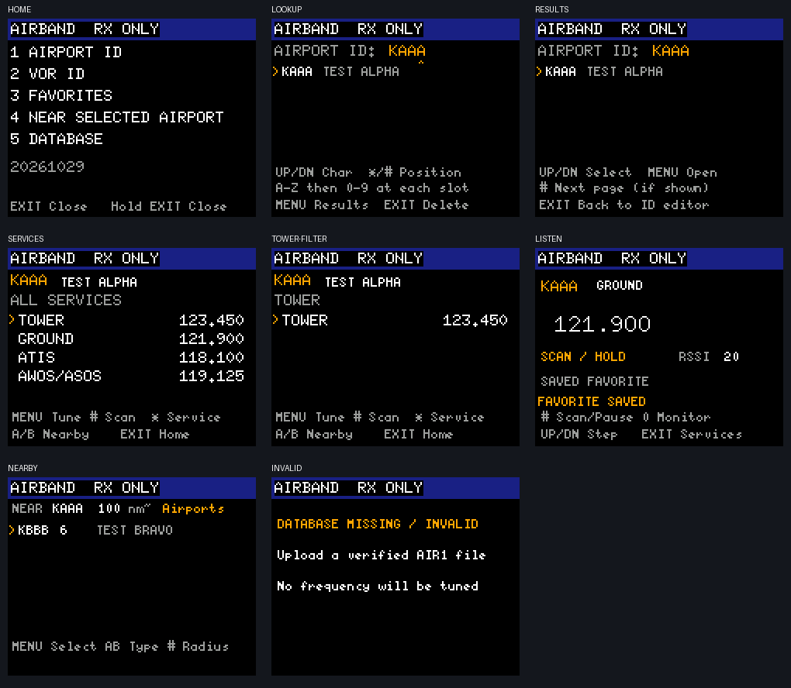

# AIRBAND

Offline, receive-only airport and VOR directory for this custom firmware.

The AIRBAND firmware profile uses plain black backgrounds for startup, firmware
menus and app screens. The documented full installation sequence also replaces
the old stored artwork with a blank image, although this firmware no longer
draws that storage area.

- Search by FAA airport identifier, ICAO airport alias, or VOR identifier.
- Select published Tower, Ground, ATIS, AWOS/ASOS, CTAF, UNICOM, Clearance,
  Approach, Departure, combined Approach/Departure, and other VHF services.
- Listen in AM, filter the service list, and scan an airport's displayed channels.
- Save eight favorites, with two-sector persistent storage and interrupted-write
  recovery. Favorites are independent of the database update partition.
- Browse airports or VORs near an airport you explicitly select, with approximate
  distance sorting and 50 / 100 / 200 nautical-mile filters.

Nearby is **not automatic location**. The proposed future implementation is in
[the separate design README](../../docs/airband-location-future/README.md).

## Release status

This is an experimental, hardware-specific release for a radio whose hold-8
screen reads exactly `5RHBK V0.14 BF`. It is not a generic UV-5RM image.

| Component | Size | SHA-256 |
|---|---:|---|
| Firmware (`UV-5RM_AIRBAND_BK4819.BF`) | 60,908 bytes | `6cf9ff04cf025ab7368396ca0d6d7892a9eaf37e44e0c51d1bf3b5c15eee1413` |
| App (`apps/airband.app`) | 29,884 bytes | `9a0b98c280816304db2f4a692d6911acf6ea23257463f329645a55792d56a6f1` |
| FAA database (`airband.db`) | 305,129 bytes | `16db31f1440a1428d290d5dc6d8fb4f94af343d201aae696aac69a55c2925208` |

The final package was flashed from macOS and the bootloader acknowledged all 60
blocks. A subsequent programming session verified the complete app image and
blank stored artwork. The database, favorites, channels, calibration, settings
and TEXT storage matched their pre-flash backups byte-for-byte; TXINH remained
on. The machine-readable record is [artifacts.json](artifacts.json).

Validation claims are deliberately separated:

| Check | Status |
|---|---|
| Firmware flash and restart | Verified on one `5RHBK V0.14 BF` radio |
| AIR1 capability and app readback | Verified |
| Blank stored artwork | Verified |
| Protected radio data preserved | Verified |
| BK4819 FM reception and internal speaker | Verified with NOAA on 162.550 MHz during bring-up |
| Earlier AIRBAND navigation/listening prototype | User-tested successfully |
| Final arrow editor and enlarged text | Offline tests pass; final physical confirmation pending |
| Final AM aviation audio | Not yet physically confirmed |
| VOR radial decoding | Not implemented |
| RF transmit/output power | Not tested as part of AIRBAND; TXINH stayed on |

The app is receive-only by construction: it disables app TX and has no code path
that enables PTT or sends tones. This does not turn the whole radio into a
receive-only appliance. Other firmware screens and apps retain their normal
capabilities, so leave TXINH enabled unless you intentionally and legally need
transmit support.



These previews use a small synthetic TEST fixture. The distributed `airband.db`
contains the FAA data described below, not those synthetic frequencies.

## Included data

FAA NASR cycle **2026-10-29**: 7,740 US airports with supported VHF communications,
783 operational VOR-family navaids, and 23,784 distinct service/frequency entries.
The 305,129-byte database includes canonical FAA identifiers, ICAO aliases and
airport/navaid coordinates. Alaska and Hawaii aliases are read from FAA data;
the builder does not blindly prepend K to every airport identifier.

Source: [FAA 28-day NASR data](https://www.faa.gov/air_traffic/flight_info/aeronav/Aero_Data/NASR_Subscription/).
Original ZIP SHA-256 hashes, database checksum and coverage details are in
[airband.json](airband.json). The effective date is displayed in the app. The
radio has no network feed and does not receive live NOTAM or runway/sector
assignment changes.

Coverage is US airports with published supported VHF frequencies, rather than
every private landing site regardless of whether it has a listed frequency.
VOR/VOR-DME/VORTAC entries expose the VHF VOR component for listening; the app
does not decode bearing, range, DME or TACAN. UHF services, NDBs and unsupported
frequency/channel formats are excluded instead of being rounded or mistuned.
Names are abbreviated to 22 ASCII characters. Duplicate service/frequency
assignments are merged; sector text and free-form remarks are omitted. Airports
may have several frequencies for a service; use current published information
when choosing a sector. Airport and navaid identifiers are separate namespaces.

## Controls

From the main radio screen, press **Band / SCAN** to open the frequency/mode
list. **AIRBAND is the first item**; press Menu to open it. It is removed from
the ordinary Menu app launcher in this profile. Closing AIRBAND returns to the
frequency/mode list. Existing saved channel-mode IDs retain their meaning.

At the AIRBAND home screen:

| Key | Action |
|---|---|
| 1 | Airport identifier search |
| 2 | VOR identifier search |
| 3 | Favorites |
| 4 | Nearby list around your saved airport center |
| 5 | Database date and counts |
| Exit / hold Exit | Close the app |

Identifier search uses a four-position alphabet editor:

- Up/Down cycles the selected position through **A–Z, then 0–9**.
- # moves right and creates the next position as `A`; * moves left.
- Exit deletes the last position. At one remaining position, Exit returns home.
- Menu switches from the editor to matching results.
- In results, Up/Down selects an entry, Menu opens it, Exit returns to the
  editor, and # advances through additional pages.

The gold `^` marks the position being edited. Search matches the visible
letters/digits against canonical FAA identifiers and verified ICAO aliases.
Identifiers accept one to four characters. Results show 24 matches per page.

At a facility's frequency list:

| Key | Action |
|---|---|
| Up/Down | Select frequency |
| Menu | Listen to the selected frequency |
| * | Cycle through the services present at this facility, then All |
| # | Scan the displayed service-filtered list |
| A/B | Save this airport as the nearby center and open Nearby |
| Exit | Return home |

While listening:

| Key | Action |
|---|---|
| Up/Down | Step to another frequency in the current service filter |
| # | Start/pause scanning |
| * | Save/remove this identifier/service/frequency as a favorite |
| 0 | Toggle Monitor; stops scanning |
| Exit / Menu | Return to the facility's service list |
| Hold Exit | Close AIRBAND |

Scanning dwells for approximately 300 ms on a clear channel, holds on an open
squelch, then resumes after approximately 1.5 seconds of quiet. Continuous ATIS
may hold the scan indefinitely; Up/Down skips it. A facility with only one
frequency remains on that frequency instead of repeatedly reinitializing RX. Scanning uses at least squelch
level 1 even if the global setting is 0. A stored favorite that no longer exists
in the current database is refused rather than tuned silently.

In Nearby, A/B switches airports/VORs, # cycles the radius, and Menu opens a
result. Distances are approximate geographic distances from the selected airport,
not measured distance from the radio. This version does not use GPS or infer a
position from signals. Removing a favorite is done with * while listening to it.

AIRBAND never enables app PTT or calls transmit/tone APIs. Exiting restores the
master VFO through the existing app loader. The main firmware may still transmit
outside this app subject to its settings.

## Install on the 5RHBK radio

Run commands from `UV-5RM Custom Firmware`. A current Python 3 and `pyserial`
are required:

```sh
python3 -m pip install pyserial
```

The port used during the successful macOS installation was
`/dev/cu.usbserial-10`; that name is not universal. Look under `/dev/cu.*` on
macOS, `/dev/ttyUSB*` or `/dev/ttyACM*` on Linux, or Device Manager on Windows.
Substitute the actual port in every command. Windows users can use `py` and a
port such as `COM3` in place of `python3` and the macOS path.

The shipped firmware was built with Rust 1.99.1 and
`--features bk4819,airband`. Do not use it on another RF-chip variant.

### Preflight and backup

1. Hold **8** during power-on and confirm the screen reads exactly
   `5RHBK V0.14 BF`. Turn the radio off afterward.
2. Start the radio normally at its main screen and make a fresh, twice-verified
   configuration and calibration backup. The output filename must not already
   exist:

```sh
python3 source-changes/radio_read.py /dev/cu.usbserial-10 backup/pre-airband.bin --calibration --verify
```

This backup contains configuration/calibration regions, not the MCU firmware.
Keep it private and in more than one location. The repository ignores `backup/`
to reduce the chance of publishing radio-specific contents.

3. Power-cycle the radio after the stock read session. Verify the release hash:

```sh
shasum -a 256 airband/UV-5RM_AIRBAND_BK4819.BF
```

Stop if the result differs from the firmware hash in the release table.

### Flash firmware

1. Connect and firmly seat both programming plugs. Turn the radio off, hold both
   side buttons while turning it on, then release them. The screen should stay
   black.
2. Probe the bootloader. This is read-only:

```sh
python3 source-changes/bootloader_probe.py /dev/cu.usbserial-10
```

3. Only after the probe succeeds, flash the exact checked image. Keep the radio,
   cable and computer undisturbed until the tool reports completion:

```sh
python3 source-changes/flash_bf.py airband/UV-5RM_AIRBAND_BK4819.BF /dev/cu.usbserial-10 6cf9ff04cf025ab7368396ca0d6d7892a9eaf37e44e0c51d1bf3b5c15eee1413
```

Do not proceed on a short write, missing acknowledgement or hash error. Record
the complete terminal output before power-cycling so the failure can be reviewed.

### Install blank artwork, database and app

After the radio boots normally, run the standard setup once to blank the stored
artwork and install the standard app set. The second argument is retained for
compatibility but is ignored; blank bytes are installed. This step temporarily
puts FOX HUNT in slot 5:

```sh
python3 source-changes/setup_radio.py /dev/cu.usbserial-10 unused-logo-argument 64 apps
```

Then install AIRBAND last so it replaces FOX HUNT in the fixed slot:

```sh
python3 source-changes/airband/install.py /dev/cu.usbserial-10 --backup backup/airband-first-install
```

This profile reserves **zero-based slot 5**, replacing FOX HUNT. The original
slot is backed up first; `apps/foxhunt.app` remains available. The installer
refuses alternate slots so the Band-menu entry always targets AIRBAND. It first
checks the read-only `AIR1` firmware capability, then validates the app ABI and
all checksums. It backs up the data/favorites area and replaced slot, uploads the
new database and app, verifies full readback, and confirms favorites were
preserved. Use a new backup-directory name for every install or update; existing
directories are intentionally refused. An interrupted database fails CRC
validation and the app refuses to tune from it.

Let the radio restart and **unplug the programming cable**. The cable connection
can route or suppress internal-speaker audio and may leave `CPS Programming` on
screen during a host session.

### Post-install acceptance check

Perform these in order and record the release hashes with any failure:

1. Confirm startup and normal firmware menus have a plain black background.
2. Press Band/SCAN and confirm `AIRBAND` is the first item.
3. Open it and confirm the header reads `AIRBAND RX ONLY` and the menu text is
   readable without clipping.
4. Select Airport or VOR. Use Up/Down to cycle the current character, `#` to
   advance, `*` to move back, Menu to show results, then Up/Down and Menu to open
   a result. Confirm one press produces one intentional editor action.
5. Open a facility and select a published, known-active AM aviation frequency.
   Confirm audio, frequency stepping and scan behavior. NOAA FM reception proves
   the receiver/speaker path, but does not validate AM aviation demodulation.
6. Listen on a VOR frequency long enough to confirm the RSSI area updates without
   whole-screen flicker or repeated receiver resets. No radial should be shown.
7. Exit AIRBAND and confirm the prior master VFO is restored. Confirm TXINH is
   still on if receive-only operation is intended.

The final arrow editor, enlarged text and AM audio should remain marked pending
until this physical checklist is completed on the final hashes above.

The generic `setup_radio.py` uses the original app layout, so running it later
will restore FOX HUNT over the reserved AIRBAND slot. The Band-menu entry will
then open that app until AIRBAND is reinstalled. Use the AIRBAND installer
again to restore the AIRBAND profile. To restore just FOX HUNT:

```sh
python3 source-changes/cps_tool.py /dev/cu.usbserial-10 app 5 apps/foxhunt.app
```

## Troubleshooting

| Symptom | Likely cause or next action |
|---|---|
| Bootloader probe gets no reply | Reseat both plugs, power off, and re-enter the two-side-button boot mode. A failed probe makes no changes. |
| Screen says `CPS Programming` | A host programming session is active or did not close cleanly. Let the tool finish; then power-cycle normally and disconnect the cable. |
| Signal meter moves but speaker is silent | Unplug the programming cable before diagnosing firmware audio. Check volume, Monitor, and squelch. |
| AIRBAND is missing from the Band/SCAN list | The non-AIRBAND firmware profile is probably installed. Check the flashed artifact hash. |
| AIRBAND opens FOX HUNT or another app | A later standard app install overwrote slot 5. Rerun the AIRBAND installer. |
| App reports invalid/missing database | Rerun the installer with a new backup directory. Do not hand-write the flash partition. |
| Identifier has no result | Confirm whether it is an FAA, ICAO or VOR identifier and check the database effective cycle. Airport and navaid namespaces are separate. |
| Scan stays on ATIS/AWOS | Continuous audio/open squelch intentionally holds scanning. Press Up/Down to skip it. |
| VOR screen flickers | Confirm the app hash, note whether scanning is active, and report the exact key sequence and frequency. |
| FM works but aviation audio does not | Test a known active AM frequency, not merely RSSI. Report the exact frequency, squelch and signal behavior. |

Do not solve a failed install by erasing broad flash regions or copying a binary
from a visually similar radio. Preserve logs and backups first; the hold-8
identifier and hashes are essential to recovery analysis.

## Reporting hardware results

A useful issue or PR comment should include:

- the exact hold-8 identifier and radio model label;
- firmware, app and database SHA-256 hashes;
- host OS, Python version and whether the cable was disconnected for audio;
- each post-install acceptance item marked pass, fail or not tested;
- the exact key sequence for UI problems;
- frequency, modulation, service type, signal indication, squelch state and
  whether Monitor changed the result for receiver problems; and
- complete tool errors or logs with personal paths/serial identifiers redacted.

Do not attach raw configuration, calibration, channels, TEXT storage or full
backup directories to a public issue. Those files may identify the radio or
contain personal operating data. Share a minimal, explicitly reviewed excerpt
only when it is necessary to reproduce a bug.

## Update FAA data without reflashing firmware

Choose the current effective date from the FAA NASR page. Do not use the preview
cycle before its effective date. Example for the included cycle:

```sh
python3 source-changes/airband/database.py --download --source backup/faa-2026-10-29 --effective 2026-10-29 --output airband/airband.db
python3 source-changes/airband/install.py /dev/cu.usbserial-10 --database-only --backup backup/airband-data-update
```

Each source ZIP's effective date is checked. `--states IL WI IN` optionally builds
a smaller regional pack. The builder fails if data exceeds the partition or a
facility exceeds the app's 64-frequency limit; it does not silently truncate.
The included nationwide pack fits with approximately 63 KB of database space
remaining. Updated favorites resolve by identifier, facility type, service and
frequency, not by an unstable database row number.

## Build and test

From `UV-5RM Custom Firmware`, with a current Rust toolchain and the ARM target:

```sh
python3 source-changes/airband/build.py
cargo build --release --locked --manifest-path firmware-source/Cargo.toml --config source-changes/airband/firmware.toml --features bk4819,airband --target-dir /tmp/uv5rm-airband-fw
python3 source-changes/elf2bin.py /tmp/uv5rm-airband-fw/thumbv7em-none-eabi/release/bf5rh-fw /tmp/airband-fw.bin
python3 source-changes/wrap_bf.py /tmp/airband-fw.bin airband/UV-5RM_AIRBAND_BK4819.BF backup/reference/factory_firmware
python3 source-changes/airband/test.py
```

The wrapper needs at least five stock reference images, as described in the
[BK bring-up guide](../../docs/BK_MACOS_BRINGUP.md). Rebuilt artifacts can have
different hashes with different compilers. The firmware limit is 60 KiB; do not
increase it to make a larger image fit. The current firmware is 60,892 bytes,
leaving 548 bytes. This AIRBAND-only build configuration enables LLVM machine
outlining to share repeated instruction sequences; use the supplied
`source-changes/airband/firmware.toml` configuration when building it. Other
firmware profiles retain their existing compiler flags. The four app segments each stay below 8 KiB and the complete
package stays below the 32 KiB slot limit. The ABI is unchanged, so other
existing apps remain compatible. Automatic AM selection now includes 136.975
MHz; this intentional fix changes default firmware binaries from earlier builds.

## Source and maintenance map

| Path | Responsibility |
|---|---|
| `firmware-source/apps/airband/src/db.rs` | AIR1 parsing, identifier input state and directory access |
| `firmware-source/apps/airband/src/logic.rs` | Home, lookup, results and facility-list UI logic |
| `firmware-source/apps/airband/receiver/` | Service/frequency selection segment |
| `firmware-source/apps/airband/listener/` | AM receive, RSSI updates, favorites and scanning |
| `firmware-source/apps/airband/nearby/` | User-centered airport/VOR distance lists |
| `firmware-source/src/app/menu_routes.rs` | Fixed first-item Band/SCAN route and compatibility tests |
| `source-changes/airband/database.py` | FAA NASR download/parser and compact AIR1 packer |
| `source-changes/airband/install.py` | Capability check, backup, upload and readback verification |
| `source-changes/airband/test.py` | Python, native app-profile and firmware-route test orchestration |
| `airband/artifacts.json` | Release sizes, hashes, build flags and validation claims |

The app is split into four overlay segments because each loaded segment must fit
within 8 KiB of RAM. Cross-segment behavior must use the existing app ABI or
flash-backed state; adding an ABI field can invalidate every existing app. The
database and favorite sectors are independent so an FAA refresh cannot silently
erase favorites. Slot 5 is fixed because the firmware's first Band/SCAN route
must have a deterministic target.

When changing UI behavior, add a native key-sequence test and render a host
preview, but still treat the physical display/keypad as a separate acceptance
step. When changing receiver behavior, test single- and multi-frequency lists,
squelch-open hold, quiet resume, manual skip, app exit and restoration of the
master VFO. AIRBAND must continue to have no path that enables TX.

## Release checklist

Before publishing another image or database:

1. Confirm the intended boot identifier and build features.
2. Run `python3 source-changes/airband/test.py` and both the original and BK4819
   base firmware builds. Do not trade away those regressions to make AIRBAND fit.
3. Check the 60 KiB firmware limit, all four 8 KiB segment limits and the 32 KiB
   packaged-app limit.
4. Validate the FAA effective date, input ZIP hashes, facility counts, database
   CRC and reserved-partition limit.
5. Produce the `.BF`, app and database hashes together and update
   `airband/artifacts.json`; never reuse an old hash in a new release note.
6. Back up a test radio, flash by exact hash, install with a new backup directory,
   and perform full app/database readback.
7. Confirm protected data, calibration, favorites and TXINH are unchanged.
8. Complete the physical acceptance checklist above, including a known active AM
   frequency. Mark unperformed checks as pending instead of inferring success.
9. Tag the commit that produced the artifacts. Publish the source, database
   provenance, hashes, supported identifier and limitations with the binaries.

For contribution strategy, see the
[repository workflow in the root README](../../README.md#recommended-repository-and-contribution-workflow).
Because the upstream repository already has an open BK4819 PR, describe which
parts overlap, which differ, and why AIRBAND depends on the chosen BK path. A
draft PR is preferable until the final physical UI/AM checks are recorded.

## Flash allocation

| Address | Size | Purpose |
|---|---|---|
| `0x194000..0x1EDFFF` | 360 KiB | AIR1 database |
| `0x1EE000..0x1EFFFF` | 8 KiB | Two alternating favorites/anchor sectors |
| `0x1F0000..0x1F3FFF` | 16 KiB | Existing TEXT log, preserved |

The `airband` build feature repurposes the old satellite-data write command as
a **512-byte block-addressed** AIR1 upload. Satellite-data upload is not compatible
with this firmware profile. The dormant satellite app's legacy addresses must
not be used with this layout. The original firmware profile retains its old
protocol. No new app API fields were added.

Tests cover the Python packer/uploader, the real Rust database and app logic
against a mocked radio API, all four segments, current FAA data and aliases,
paged ambiguous searches,
CRC failures, scan hold/resume, interrupted favorite writes, geographic sorting,
upper-airband AM selection, stale favorites and absence of TX requests.
RSSI refreshes update only the meter field; scan/key updates keep the header
and footer in place instead of clearing the full screen. Tests assert that a
steady VOR does not trigger whole-screen clears or repeated retunes.
Host-rendered screens are previews, not evidence of physical radio operation.
The final AIRBAND firmware and app were installed on the 5RHBK V0.14 BF radio
from macOS and verified with full readback. The stored artwork read back as all
black. The existing database, favorites, channels, factory calibration,
settings and TEXT log were verified byte-for-byte unchanged, and TXINH remained
on. The Band-menu route, arrow-based identifier editor, larger text and redraw
fixes pass host checks; their final physical UI behavior still requires user
confirmation.

## VOR radial display

This version listens to the published VOR frequency; it **does not decode a
radial**. A radial requires phase comparison of the two 30 Hz navigation
components, including the component carried by the 9,960 Hz subcarrier. See the
[FAA VOR signal standard](https://www.faa.gov/documentLibrary/media/Advisory_Circular/AC00-31a.pdf).
The app API exposes tuning, RSSI and squelch but no received-baseband sample
stream. RSSI, station coordinates and Morse identification cannot replace those
phase measurements. A decoder would first require a verified signal path that
preserves the navigation components, then sampling, DSP and measured validation.
A speaker recording must not be assumed to preserve that bandwidth or phase.
No inferred radial is displayed from the selected nearby airport.
